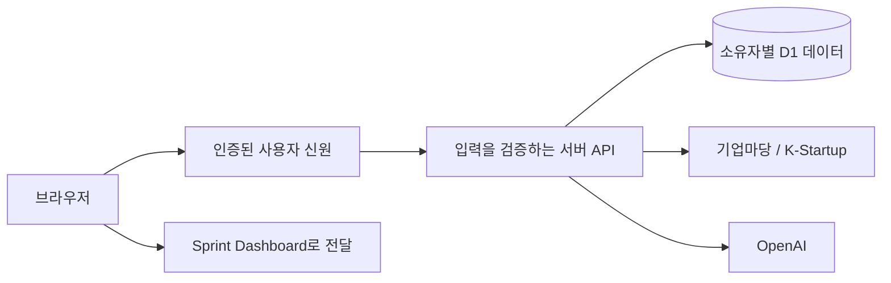

<div align="center">

# Grant Project

[English](README.md) · 한국어

**지원사업을 찾고, 우리 기업에 적합한지 평가하고, 신청을 준비합니다.**

[필수 준비 사항](#필수-준비-사항) · [로컬에서 실행](#로컬에서-실행) · [기업 정보 설정](#기업-정보-설정) · [기능](#기능) · [검증](#검증)

</div>


*이 화면에는 가상 기업과 공고, 설명용 평가 등급을 사용했습니다. 실제 공고나 AI 평가 결과가 아닙니다. 새 워크스페이스는 비어 있는 상태로 시작합니다.*

## 필수 준비 사항

기업 정보와 공고는 처음에 비어 있습니다. 본인의 기업 정보를 입력한 뒤 공식 API에서 공고를 수집하거나 직접 확보한 자료를 가져오세요. 기업 정보 저장, 검색, 즐겨찾기, 보관 기능은 AI 없이 사용할 수 있습니다.

| 준비 사항 | 용도 | 설정 방법 |
| --- | --- | --- |
| Node.js 22.13 이상 및 npm | 로컬 개발 | `npm ci`로 버전이 고정된 의존성 설치 |
| D1 `DB` 바인딩 | 데이터 영구 저장 | 로컬에서는 Wrangler/Miniflare의 SQLite, 비공개 Sites 호스팅에서는 연결된 D1 사용 |
| 운영 환경 인증 | 호스팅된 서비스 접근 | 기존 Sites 인증 또는 본인의 Cloudflare Access 애플리케이션 사용. [독립 호스팅](docs/SELF-HOSTING.md) 참고. 로컬 개발에는 두 서비스의 계정 모두 불필요 |
| 기업 정보 | 추천 및 신청 자격 판단 | 기업명, 기업 유형, 설립일, 업종, 시·도, 사업 개요 입력 |
| `BIZINFO_API_KEY` | 기업마당 공고 수집 | [기업마당 API 이용 안내](https://www.bizinfo.go.kr/apiList.do)에서 본인의 키 발급 |
| `KSTARTUP_API_KEY` | K-Startup 공고 수집 | [공공데이터포털](https://www.data.go.kr/)에서 K-Startup 공고 서비스 이용 신청 |
| `OPENAI_API_KEY` + `OPENAI_MODEL` | AI 평가 및 재평가 | 본인의 서버 키와 구조화된 출력을 지원하는 모델 설정. 평가 작업 시 API 사용량 발생 |
| `SPRINT_SERVICE_URL` | 신청 준비 작업 전달 | 본인의 Sprint Dashboard 서비스 오리진. 선택 사항 |

두 공고 API는 각각 독립적으로 설정할 수 있습니다. 설정되지 않은 출처가 있으면 수집이 불완전하다고 표시합니다. AI 설정이 없으면 평가 등급을 임의로 생성하지 않습니다.

## 로컬에서 실행

```sh
git clone https://github.com/dpwld/grant-project.git
cd grant-project
npm ci
npm run setup
npm run dev -- --port 4311
```

로컬 설정에는 ChatGPT 계정이나 유료 API 키가 필요하지 않습니다. `npm run setup`은 서비스를 빌드하고 저장소에 포함된 로컬 마이그레이션을 적용하며, 예시 데이터를 넣지 않습니다. [설치 안내](docs/INSTALLATION.md), [본인 Cloudflare 계정에서 독립 호스팅](docs/SELF-HOSTING.md), [기여 안내](CONTRIBUTING.md)를 참고하세요.

사용할 기능에 필요한 본인의 키만 `.dev.vars`에 추가하세요. 외부 연동 설정값이 비어 있어도 기본 저장 기능은 동작합니다. `db:migrate`는 `.wrangler/state` 아래의 로컬 데이터베이스에 아직 적용하지 않은 마이그레이션을 적용합니다. 이후 스키마를 변경하려면 `db/schema.ts`를 수정한 뒤 `npm run db:generate`, `npm run db:migrate` 순서로 실행하세요.

`http://127.0.0.1:4311`을 여세요. 로컬 런타임은 루프백 주소에서만 개발용 사용자 신원을 제공합니다. 호스팅된 서비스의 요청은 인증된 서버 사용자 신원을 사용합니다. 서버에서 소유자별로 데이터를 구분하며, 기업 정보를 브라우저 저장소에 보관하지 않습니다.

## 기업 정보 설정

처음 사용하면 추천 화면보다 먼저 **Tell us about your company** 화면이 열립니다. 모든 입력란은 비어 있습니다. 필수 항목 여섯 개를 작성한 뒤 **Save and continue**를 선택하세요. 펼칠 수 있는 상세 정보 영역에서 매칭 선호 조건, 인증, 키워드, 직원 수, 기술, 매출, 성과를 선택적으로 입력할 수 있습니다.

**Save draft**는 기업명만 있으면 작성 중인 정보를 계정에 저장합니다. 새로고침하면 저장된 미완성 기업 정보에서 이어서 작성할 수 있습니다. 필수 항목 여섯 개에 모두 유효한 정보를 입력하면 추천 기능을 사용할 수 있습니다. 기존 기업 정보가 미완성인 경우에도 같은 설정 화면이 열리며, 이미 완성된 경우에는 추천 화면으로 이동합니다.

나중에 저장된 정보를 수정하려면 **Profile**을 사용하세요. 페이지를 열어 둔 상태에서 탭을 전환하면 저장하지 않은 편집 내용이 유지됩니다. 새로고침하거나 페이지를 떠나기 전에는 저장해야 합니다. 유효하지 않은 날짜, 미래의 설립일, 음수 또는 소수인 직원 수, 길이 제한을 넘긴 값은 입력 화면과 서버 모두에서 거부합니다. 저장이 거부되면 기존에 저장된 기업 정보는 유지되며, 입력한 내용도 남아 있어 수정하거나 다시 시도할 수 있습니다.

기업 정보를 변경하면 이전 평가는 재평가가 필요한 상태로 표시됩니다. 기존 공고를 다시 평가하려면 **Review all again**을 사용하세요. 현재 AI 설명은 영어로 요청하지만, 공식 공고, 출처에서 그대로 인용한 문구, 사용자가 입력한 내용은 원래 언어를 유지합니다. 과거 평가도 저장된 상태로 남으며, 평가 버전이 오래되면 재평가 대상으로 표시합니다.


## 공고 가져오기

실제 공고 객체를 담은 UTF-8 JSON 배열을 가져올 수 있습니다. 각 객체에는 `source`, `sourceId`, `title`, `url`, `summary`, `supportTypes`, `targets`, `region`, `amountText`, `applyStart`, `applyEnd` 필드가 있습니다.

- `source`: `bizinfo`, `kstartup`, `manual` 중 하나.
- `sourceId`: 해당 출처에서 공고를 식별하는 고유 ID.
- 날짜: `YYYY-MM-DD` 또는 `null`. 지원 유형과 지원 대상: 문자열 배열.
- 제한: 요청당 최대 500개 레코드, 1 MB. [필드 규격](public/import-format.json)을 참고하세요.

유효하지 않은 가져오기 요청은 변경 사항을 저장하기 전에 거부합니다. 출처와 ID가 같은 공고를 다시 가져오면 공고 내용을 갱신하면서 즐겨찾기, 피드백, 보관 상태, 기존 평가를 유지합니다. 한국어 제공기관 필드명과 공고 파싱도 계속 지원합니다.

## 기능

| 작업 | 동작 |
| --- | --- |
| 공고 수집 | 지원하는 기업마당 및 K-Startup의 모든 페이지를 가져오고 중복 공고를 갱신 |
| 기업 정보 | 첫 사용 설정, 임시 저장, 완성된 정보 수정, 매칭 프리셋, 작성 완성도 |
| 공고 평가 | 실제 AI 등급, 신청 자격 확인 항목, 판단 근거, 검토한 출처의 범위 |
| 일괄 평가 | 진행 상황, 중지·재개, 실패 항목 재시도, 오래된 평가 감지 |
| 평가 결과 정리 | 등급 필터, 검색, 출처·정렬 필터, 즐겨찾기, 피드백, 보관·복원, 상세 패널 |
| 신청 준비 | 본인의 Sprint Dashboard에서 전달 내용을 검토하고 영구 저장되는 작업 생성. 같은 내용을 반복 전달해도 작업은 중복 생성되지 않음 |

AI 결과에는 검토한 출처의 범위와 한계를 표시합니다. PDF/HWP 첨부파일 전체를 검토했다고 주장하지 않습니다. 최종 신청 자격은 공식 출처에서 확인하세요.

## 로컬 스크린샷 예시

**비어 있는 로컬 개발 워크스페이스**에서 README 예시를 재현하려면 아래 명령을 각각 실행하세요.

```sh
node --experimental-strip-types scripts/readme-example.mjs seed
# 스크린샷 촬영 후 생성한 예시 데이터만 삭제:
node --experimental-strip-types scripts/readme-example.mjs cleanup
```

이 도구는 `127.0.0.1:4311`과 로컬 D1만 사용하며 리디렉션을 거부합니다. 영어로 된 가상 기업, 공고 8개, 설명용 평가를 생성하고, 생성된 ID를 Git에서 제외되는 `.wrangler` 매니페스트에 기록합니다. 실제 공고 수집이나 유료 AI 호출은 하지 않습니다. 설치, 시작, 배포 과정에서 자동으로 실행되지 않습니다.

## 호스팅

소스 저장소는 공개되어 있습니다. 작성자가 운영하는 호스팅 서비스의 접근 범위는 **비공개**입니다. `.openai/hosting.json`의 기존 프로젝트 식별 정보와 `DB` 바인딩을 보존하세요. 서버 비밀값은 호스팅 환경에 설정하고 Git에 넣지 마세요. 공개 범위를 변경하려면 소유자의 명시적인 지시가 필요합니다.

독립적으로 설치하려면 [독립 호스팅 안내](docs/SELF-HOSTING.md)에 따라 본인의 Workers, D1, Cloudflare Access를 설정하세요. 기본 Sites 모드의 Worker를 그대로 외부에 공개해 인증 수단으로 사용하지 마세요.

## 검증



- `components/grants/`: 기업 정보 설정, 추천, Profile, Archive, 상세 화면.
- `lib/grants/`: 수집, 공식 출처 조회, 평가 버전, 처리 범위를 제한한 평가 대기열.
- `app/api/grants/`: 인증, 입력 검증, 실제 서버 작업.
- `db/`, `drizzle/`: 소유자별 영구 저장과 마이그레이션.
- `tests/`: 도메인 검증과 로컬 Worker/D1 통합 점검.

```sh
npm test
npm run typecheck
npm run build
# 별도 터미널에서 빌드된 Worker 실행:
npm start -- --port 4315
# 서로 격리된 일회용 테스트 소유자 사용:
npm run test:integration
```

통합 테스트는 빈 초기 상태, 임시 저장·다시 불러오기, 기업 정보 설정 완료, 정보 수정, 유효하지 않은 수정 거부, 소유자 격리, 가져오기, 공고 정리, 외부 연동 설정 누락을 확인합니다. 수집 및 AI 키가 설정되지 않은 환경을 전제로 하며, 유료 AI 호출은 하지 않습니다. Worker를 재시작한 뒤 동일한 `TEST_OWNER_SUFFIX`를 사용해 `node tests/integration.mjs --verify-restart`를 실행하면 데이터 유지 여부를 확인할 수 있습니다.

[기능 동등성](docs/FEATURE-PARITY.md) · [구현 보고서](docs/IMPLEMENTATION-REPORT.md)

실제 외부 공고 수집과 유료 AI 응답은 운영자 본인의 인증 정보와 별도의 검증이 필요합니다. 기업 운영 기록, 인증 정보, 재무 기록, 고객 데이터는 포함되어 있지 않습니다.

글꼴: [Pretendard](https://github.com/orioncactus/pretendard), SIL OFL. 런타임과 외부 패키지에는 각각의 라이선스가 적용됩니다. 프로젝트 전체에 오픈소스 라이선스가 부여되었다는 의미는 아닙니다.
