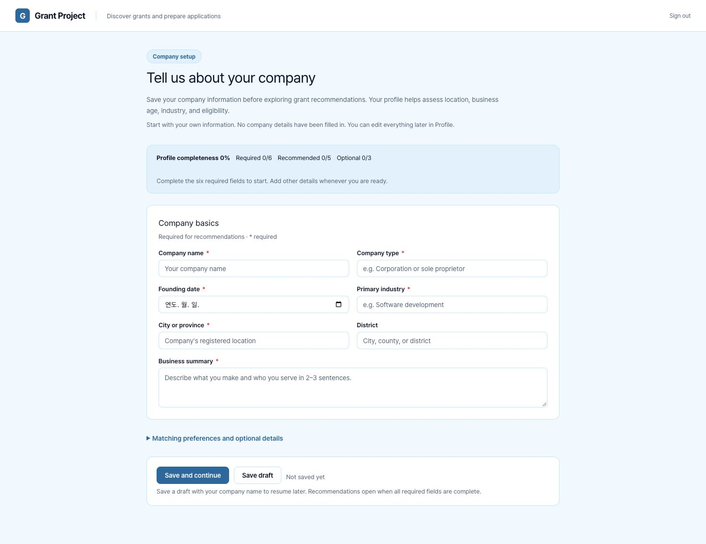
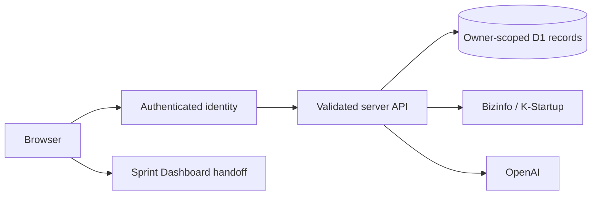

<div align="center">

# Grant Project

English · [한국어](README.ko.md)

**Find grants, assess their fit for your company, and prepare applications.**

[Prerequisites](#prerequisites) · [Run locally](#run-locally) · [Company setup](#company-setup) · [Features](#features) · [Verification](#verification)

</div>


*The screenshot uses a fictional company, announcements, and illustrative grades. These are not real announcements or AI review results. New workspaces start empty.*

## Prerequisites

Company information and announcements start empty. Enter your own company details, then collect announcements from official APIs or import records you have obtained. Profile storage, search, stars, and archive work without AI access.

| Requirement | Used for | Configuration |
| --- | --- | --- |
| Node.js 22.13+ and npm | Local development | Install pinned dependencies with `npm ci` |
| D1 `DB` binding | Persistent records | Local SQLite through Wrangler/Miniflare; connected D1 for private Sites hosting |
| Production authentication | Hosted access | Existing Sites identity or your own Cloudflare Access application; see [Self-hosting](docs/SELF-HOSTING.md). Local development needs neither account |
| Company profile | Recommendations and eligibility | Enter company name, type, founding date, industry, city/province, and business summary |
| `BIZINFO_API_KEY` | Bizinfo collection | Obtain your own key from [Bizinfo API access](https://www.bizinfo.go.kr/apiList.do) |
| `KSTARTUP_API_KEY` | K-Startup collection | Request access to the K-Startup announcement service through [data.go.kr](https://www.data.go.kr/) |
| `OPENAI_API_KEY` + `OPENAI_MODEL` | AI review and reassessment | Supply your server key and a model supporting structured output; review actions incur API usage |
| `SPRINT_SERVICE_URL` | Application-preparation task handoff | Your Sprint Dashboard service origin; optional |

Either announcement API can be configured independently. Missing sources are reported as incomplete collection. Without AI configuration, the service does not invent grades.

## Run locally

```sh
git clone https://github.com/dpwld/grant-project.git
cd grant-project
npm ci
npm run setup
npm run dev -- --port 4311
```

Local setup needs no ChatGPT account or paid API keys. `npm run setup` builds the service and applies committed local migrations without seeding data. See [Installation](docs/INSTALLATION.md), [Self-hosting in your own Cloudflare account](docs/SELF-HOSTING.md), and [Contributing](CONTRIBUTING.md).


Add only your own keys for the features you use to `.dev.vars`. Basic storage works with empty integration values. `db:migrate` applies pending migrations to the local database under `.wrangler/state`. For later schema changes, edit `db/schema.ts`, run `npm run db:generate`, then `npm run db:migrate`.

Open `http://127.0.0.1:4311`. The local runtime provides a development identity on loopback only. Hosted requests use authenticated server identities. Records are scoped by owner on the server; company information is not stored in browser storage.

## Company setup

On first use, Grant Project opens **Tell us about your company** before recommendations. All inputs are blank. Complete the six required fields, then select **Save and continue**. Optional matching preferences, certifications, keywords, employee count, technology, revenue, and achievements are available in the expandable details section.

**Save draft** requires a company name and saves incomplete information to your account. Reloading resumes an incomplete saved profile. Recommendations become available once all six required fields contain valid information. Existing incomplete profiles use the same setup screen; already complete profiles continue to recommendations.

Use **Profile** to edit saved information later. Switching tabs keeps unsaved edits while the page stays open. Save before reloading or leaving. Invalid dates, future founding dates, negative or fractional employee counts, and oversized values are rejected in the form and on the server. A rejected save preserves the previous stored profile and keeps your entries available to correct or retry.

Profile changes mark prior reviews stale. Use **Review all again** to reassess existing announcements. Current AI explanations are requested in English; official announcements, exact source quotations, and user-entered content retain their original language. Historical reviews remain stored and are marked for reassessment when their review version is outdated.



## Import announcements

Import a UTF-8 JSON array of real announcement objects. Each object has `source`, `sourceId`, `title`, `url`, `summary`, `supportTypes`, `targets`, `region`, `amountText`, `applyStart`, and `applyEnd`.

- `source`: `bizinfo`, `kstartup`, or `manual`.
- `sourceId`: the source's unique announcement identifier.
- Dates: `YYYY-MM-DD` or `null`; support types and targets: arrays of strings.
- Limits: 500 records and 1 MB per request. See the [field specification](public/import-format.json).

Invalid imports are rejected before changes are saved. Reimporting the same source and ID updates announcement content while preserving stars, feedback, archive state, and existing assessments. Korean provider field names and announcement parsing remain supported.

## Features

| Workflow | Behavior |
| --- | --- |
| Collect announcements | Fetch all supported Bizinfo and K-Startup pages and update duplicates |
| Company profile | First-run setup, saved drafts, editable complete profile, matching presets, completeness |
| Review announcements | Real AI grades, eligibility checkpoints, rationale, and source coverage |
| Batch review | Progress, stop/resume, failed-item retry, and stale review detection |
| Organize review | Grade filters, search, source/sort filters, stars, feedback, archive/restore, detail drawer |
| Prepare applications | Review the handoff in your Sprint Dashboard and create a persistent task; repeated handoffs do not duplicate tasks |

AI results describe their source coverage and limits. They do not claim full PDF/HWP attachment review. Verify final eligibility in the official source.

## Local screenshot examples

To reproduce the README example in an **empty local development workspace**, run these commands separately:

```sh
node --experimental-strip-types scripts/readme-example.mjs seed
# After screenshots, remove only the generated example records:
node --experimental-strip-types scripts/readme-example.mjs cleanup
```

The helper only uses `127.0.0.1:4311` and local D1 and rejects redirects. It creates a fictional English-language company, eight announcements, and illustrative assessments, recording generated IDs in an ignored `.wrangler` manifest. It makes no real collection or paid AI calls. It is never run automatically during install, startup, or deployment.

## Hosting

The source repository is public. The author’s hosted workspace remains **private**. Preserve the existing project identity and `DB` binding in `.openai/hosting.json`. Configure server secrets in the hosting environment and keep them out of Git. Visibility changes require the owner's explicit instruction.

For an independent installation, follow [Self-hosting](docs/SELF-HOSTING.md) to configure your own Workers, D1 and Cloudflare Access. Do not expose the default Sites-mode Worker directly as public authentication.

## Verification



- `components/grants/`: company setup, recommendations, Profile, Archive, and detail views.
- `lib/grants/`: collection, official-source retrieval, assessment versions, and bounded review queue.
- `app/api/grants/`: authentication, validation, and real server operations.
- `db/`, `drizzle/`: owner-scoped persistence and migrations.
- `tests/`: domain validation and local Worker/D1 integration checks.

```sh
npm test
npm run typecheck
npm run build
# Run the built Worker in a separate terminal:
npm start -- --port 4315
# Uses isolated disposable test owners:
npm run test:integration
```

The integration suite checks empty state, draft save/reload, completed setup, profile editing, rejected updates, owner isolation, imports, curation, and missing integration configuration. It expects collection and AI keys to be unset and makes no paid AI calls. A fixed `TEST_OWNER_SUFFIX` can be reused with `node tests/integration.mjs --verify-restart` after restarting the Worker to verify persistence.

[Feature parity](docs/FEATURE-PARITY.md) · [Implementation report](docs/IMPLEMENTATION-REPORT.md)

Live external collection and paid AI responses require the operator's own credentials and separate verification. No company operating records, credentials, financial records, or customer data are included.

Font: [Pretendard](https://github.com/orioncactus/pretendard), SIL OFL. Runtime and third-party packages retain their respective licenses. No project-wide open-source license is implied.
