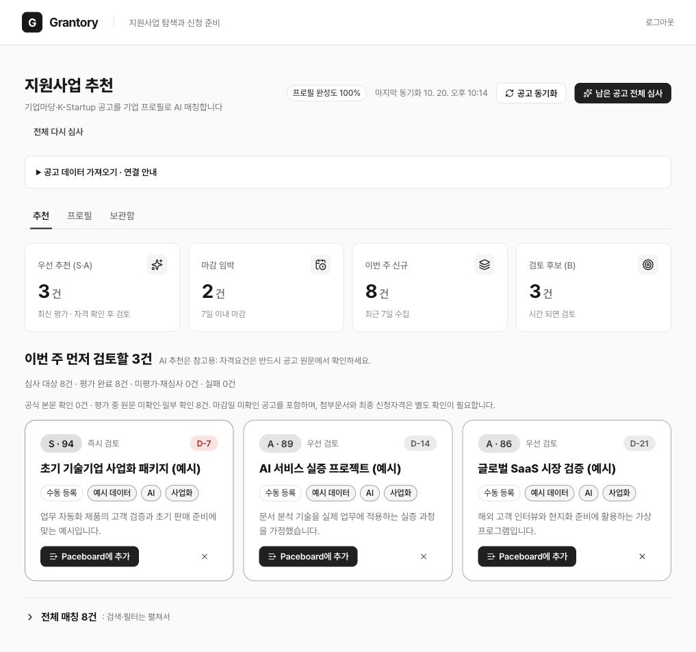
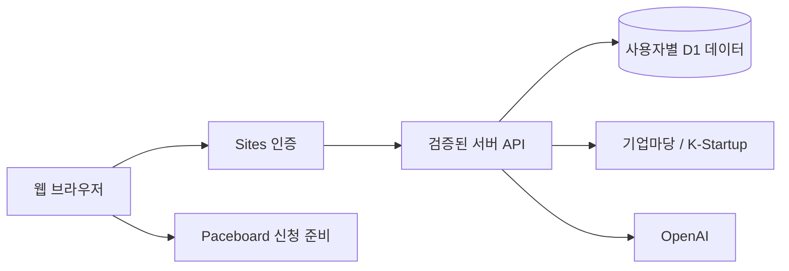

<div align="center">

# Grantory

**지원사업을 찾고, 우리 기업에 맞는 공고를 검토하고, 신청 준비로 연결하는 웹서비스.**

[시작 전 준비](#시작-전-준비) · [실행하기](#실행하기) · [주요-기능](#주요-기능) · [구조와-검증](#구조와-검증)

</div>



*가상 기업·지원사업·평가 등급으로 구성한 예시 화면입니다. 실제 공고나 AI 심사 결과가 아닙니다. 실제 서비스는 빈 데이터베이스로 시작합니다.*

## 시작 전 준비

처음에는 기업 프로필과 공고가 비어 있습니다. 본인 기업 정보를 입력하고, 공식 API 또는 직접 확보한 공고 파일로 데이터를 채웁니다. 기본 화면·프로필 저장·검색·별표·보관함은 AI API가 없어도 사용할 수 있습니다.

| 준비 항목 | 필요한 기능 | 설정 / 준비 방법 |
| --- | --- | --- |
| Node.js 22.13 이상, npm | 로컬 실행 | `npm ci`로 고정 의존성 설치 |
| D1 `DB` 바인딩 | 모든 데이터 저장 | 로컬 SQLite는 Wrangler/Miniflare, 비공개 Sites 배포는 연결된 D1 사용 |
| ChatGPT 로그인 | 호스팅된 웹서비스 접근 | Sites 인증 사용. 로컬 loopback만 개발 로그인 제공 |
| 기업 프로필 | 기업별 공고 평가 | 회사명·설립일·업종·지역·사업 요약·인원·인증·기술·키워드·매칭 기준 직접 입력 |
| `BIZINFO_API_KEY` | 기업마당 공고 동기화 | [기업마당 정책정보 개방](https://www.bizinfo.go.kr/apiList.do)에서 본인 인증키 준비 |
| `KSTARTUP_API_KEY` | K-Startup 공고 동기화 | [공공데이터포털](https://www.data.go.kr/)에서 창업진흥원 K-Startup 조회서비스 활용 신청 |
| `OPENAI_API_KEY` + `OPENAI_MODEL` | AI 매칭 / 재심사 | 본인 서버용 키와 구조화 출력 지원 모델 지정. 버튼 실행 시 API 사용량 발생 |
| `SPRINT_SERVICE_URL` | 공고 → Paceboard 태스크 | 본인의 Paceboard 웹서비스 origin. 선택 설정 |

수집 API는 둘 중 하나만 설정할 수도 있습니다. 미설정 출처는 별도로 안내되며, 해당 출처까지 수집했다고 표시하지 않습니다. AI 키가 없으면 등급을 임의 생성하지 않습니다.

### 준비할 데이터

- **기업 정보:** 프로필 탭에 직접 작성합니다. 기존 회사 정보나 직원 명부가 포함되어 있지 않습니다.
- **공고:** API 수집 또는 UTF-8 JSON 배열을 가져옵니다. 각 객체는 `source`, `sourceId`, `title`, `url`, `summary`, `supportTypes`, `targets`, `region`, `amountText`, `applyStart`, `applyEnd`를 가집니다.
- `source`는 `bizinfo`, `kstartup`, `manual`; `sourceId`는 해당 출처의 고유 번호입니다. 날짜는 `YYYY-MM-DD` 또는 `null`, 지원 유형·대상은 문자열 배열입니다.
- 한 번에 최대 500건 / 1MB. [필드 명세](public/import-format.json)를 확인하세요. 잘못된 입력은 저장 전에 거절합니다. 같은 출처·번호를 다시 가져와도 별표·피드백·기존 평가를 지우지 않습니다.

## 실행하기

```sh
npm ci
cp .env.example .dev.vars
npm run db:migrate
npm run dev -- --port 4311 --hostname 127.0.0.1
```

`.dev.vars`에는 사용할 기능의 본인 API 키만 넣습니다. 빈 값으로 시작해도 기본 저장 기능은 동작합니다. `db:migrate`는 `.wrangler/state`의 로컬 DB에 아직 적용하지 않은 마이그레이션만 적용합니다. 이후 스키마 변경은 `db/schema.ts` 수정 → `npm run db:generate` → `npm run db:migrate` 순서입니다.

브라우저에서 `http://127.0.0.1:4311`을 엽니다. loopback 개발 로그인은 저장소 기본 런타임이 제공하는 테스트용 신원이며, 호스팅 인증에는 사용되지 않습니다. 사용자와 데이터는 서버에서 구분합니다.

README 예시 화면을 재현하려면 비어 있는 로컬 개발 워크스페이스에서 아래 명령을 별도로 실행합니다.

```sh
node --experimental-strip-types scripts/readme-example.mjs seed
# 촬영 후 생성한 예시만 제거
node --experimental-strip-types scripts/readme-example.mjs cleanup
```

이 도구는 `127.0.0.1:4311`과 로컬 D1만 사용하며 리디렉션을 거절합니다. 가상 기업·공고 8건과 설명용 평가를 만들고, 생성한 ID를 무시된 `.wrangler` 파일에 기록합니다. 실제 공고 수집이나 AI 호출은 하지 않습니다. 설치·실행·배포에는 자동으로 포함되지 않습니다.

### 호스팅

이 저장소는 현재 **비공개**입니다. `.openai/hosting.json`의 기존 프로젝트와 `DB` 연결을 유지해 Sites로 배포합니다. 서버 환경변수는 배포 환경의 비밀값 설정으로 관리하고 Git에 커밋하지 않습니다. 공개 범위는 소유자의 별도 결정 전까지 변경하지 않습니다.

일반 호스팅으로 옮길 경우 Sites의 신뢰된 사용자 헤더를 그대로 외부에 노출하면 안 됩니다. 해당 호스팅의 인증과 DB 바인딩을 먼저 연결해야 합니다.

## 주요 기능

| 업무 흐름 | 동작 |
| --- | --- |
| 공고 모으기 | 기업마당·K-Startup 페이지를 끝까지 수집하고 중복 공고 갱신 |
| 기업 프로필 | 원래 프로필 필드, 매칭 기준 프리셋, 완성도 확인과 서버 저장 |
| 공고 심사 | 공식 원문과 프로필을 바탕으로 등급·자격 체크포인트·추천 이유 저장 |
| 전체 / 재심사 | 배치별 진행률·중지·실패 재시도, 프로필·공고 변경 시 재평가 표시 |
| 검토 정리 | 등급별 필터, 검색, 별표, 피드백, 제외·복원, 상세 드로어 |
| 신청 준비 | 별도 Paceboard 웹서비스에서 내용을 확인하고 실제 태스크 생성. 동일 공고 재전송은 중복 생성 방지 |

AI 결과에는 확인한 원문 범위와 한계가 남습니다. 첨부 PDF/HWP를 검토했다고 표시하지 않으며, 최종 자격 판단은 공식 원문을 기준으로 합니다.

## 구조와 검증



- `components/grants/`: 원래 추천·프로필·보관함 화면과 상세 컴포넌트
- `lib/grants/`: 수집, 원문 확인, 평가 버전, 배치 큐
- `app/api/grants/`: 사용자 인증, 입력 검증, 실제 서버 작업
- `db/`, `drizzle/`: 소유자별 영속 데이터와 스키마 마이그레이션
- `tests/`: 도메인 검증과 실제 로컬 Worker/D1 통합 확인

```sh
npm test
npm run typecheck
npm run build
# 별도 터미널에서 built Worker를 127.0.0.1:4315로 실행한 뒤:
npm start -- --port 4315
# 테스트 데이터는 분리된 검증용 소유자에만 생성됩니다.
npm run test:integration
```

[원본 기능 대응표](docs/FEATURE-PARITY.md) · [검증 결과와 제한](docs/IMPLEMENTATION-REPORT.md)

외부 서비스의 실제 수집·유료 AI 호출은 본인 키를 연결한 뒤 검증해야 합니다. 테스트에서는 비용이 발생하는 AI를 호출하지 않습니다. 회사 운영 DB·인증키·금융 및 고객 데이터·기존 Git 이력은 포함하지 않습니다.

서체: [Pretendard](https://github.com/orioncactus/pretendard), SIL OFL. 런타임과 서드파티 패키지는 각 라이선스를 따릅니다. 프로젝트 전체에 새로운 오픈소스 라이선스를 부여하지 않았습니다.
